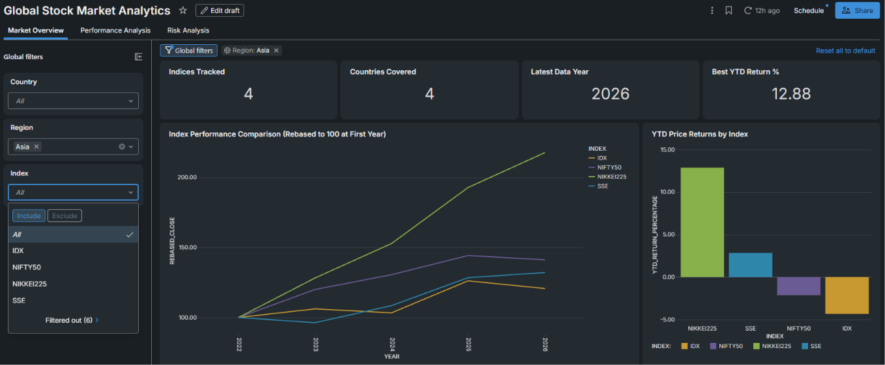
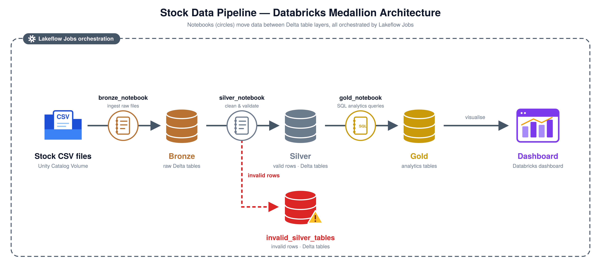

## 🌍 Global Stock Market Analytics

An end-to-end financial data engineering and analytics project built with Databricks, PySpark, Delta Lake, and SQL to analyze global stock market indices, evaluate market performance, and compare historical volatility across countries.

### 🎯 Project Objectives

- Process a large-scale dataset containing approximately 4.6 million stock market records.

- Implement a Bronze, Silver, and Gold data architecture using Delta Lake.

- Transform raw data into standardized and analysis-ready datasets using PySpark.

- Validate data quality and handle missing, invalid, or duplicate records.

- Develop SQL analytics to evaluate returns, volatility, and country-level performance.

- Build interactive Databricks dashboards to communicate market trends and risk indicators.

### 🏗️ Architecture

### 🥉 Bronze Layer — Data Ingestion

The Bronze layer stores the ingested source data in Delta format, preserving the original records as the foundation for downstream transformations.

Key activities:

- Load the CSV dataset into Databricks.

- Infer the source schema.

- Persist raw records as Delta tables.

- Validate initial row counts and schema.

### 🥈 Silver Layer — Data Transformation 

The Silver layer prepares the source data for reliable analysis through PySpark transformations.

Key activities:

- Trim string columns

- Attaching origin country of index and region it belongs to

- Calculate daily returns for individual stock indices.

- Prepare records for data quality validation.

###🛡️ Data Quality Validation

Data quality checks help identify issues that could affect downstream financial calculations.

Validation areas include:

- Missing values in important fields (example: prices columns).

- Duplicate index-date records.

- Invalid or non-positive closing prices.

- Invalid or unexpected date values.

- Row-count and data completeness checks.

### 🥇 Gold Layer — Analytical Processing

The Gold layer contains business-oriented SQL analytics derived from the validated Silver data.

Analytical datasets and views support:

- Index-level performance analysis.

- Year-to-date returns.

- Average daily returns.

- Historical volatility and risk comparisons.

- Country-level performance rankings.

- Monthly and multi-year market trends.

### 🛠️ Technology Stack

| Technology | Purpose | 
| --- | --- |
| Databricks Worspace and Unity Catalog | Analytics workspace | 
| PySpark | Distributed data transformation and processing | 
| Delta Lake | Structured storage for Bronze, Silver and Gold datasets | 
| Spark SQL | Financial analytics and aggregations | 
| Databricks Dashboard | Data visualization | 
| LakeFlow Jobs | ETL pipeline orchestration | 
| Github | Version control and project documentation | 

###🔮 Potential Future Enhancements

- Add incremental ingestion using AutoLoader

- Include 2026 financial year data from March to December onwards

- Handle Schema evolution

- Include Foreign Exchange data for each month by year to convert stock prices to USD for more fairer comparison

